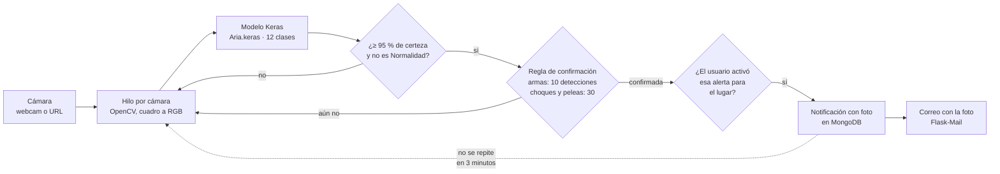

# AlertAI

[](https://github.com/CarlosIsaelRamirezGonzalez/AlertIA/actions/workflows/tests.yml)


AlertAI vigila cámaras con inteligencia artificial y avisa por correo cuando detecta una situación de riesgo: armas, incendios, peleas, choques, ataques de perro o personas heridas.

Es una aplicación web en **Flask** con **MongoDB**. Cada usuario registra sus cámaras, que pueden ser webcams o cámaras de seguridad por URL, y elige qué alertas quiere recibir según el lugar. Mientras tiene la página de inicio abierta, un modelo de **TensorFlow/Keras** analiza cada cámara cuadro por cuadro. Cuando detecta una amenaza varias veces seguidas, guarda una notificación con la foto y envía un correo.

<!-- TODO: captura del panel con las cámaras (docs/assets/panel.png) -->
<!-- TODO: captura de una notificación con su foto (docs/assets/notificacion.png) -->
<!-- TODO: captura del correo de alerta (docs/assets/correo.png) -->

## Cómo funciona una alerta



Las reglas están en `flasky/app/detection.py` y tienen pruebas en `flasky/tests/`. El envío de SMS con Twilio existe en el código, pero está desactivado.

## Documentación

| Documento | Qué contiene |
|---|---|
| [docs/sistema.md](docs/sistema.md) | Cómo funciona todo: arquitectura, flujos, modelo de datos, rutas, detección y correos |
| [docs/decisiones.md](docs/decisiones.md) | Por qué cada modelo y cada tecnología |
| [docs/instalacion.md](docs/instalacion.md) | Cómo instalarlo y correrlo |
| [docs/inteligencia-artificial.md](docs/inteligencia-artificial.md) | El modelo, sus clases y los scripts para probarlo |
| [docs/problemas-conocidos.md](docs/problemas-conocidos.md) | Errores y riesgos encontrados en el código |
| [docs/seguridad.md](docs/seguridad.md) | Manejo de secretos y credenciales |

## Inicio rápido

```powershell
python -m venv venv
venv\Scripts\activate
pip install -r requirements.txt
copy .env.example flasky\.env   # y llena los valores
cd flasky
flask run
```

Abre http://127.0.0.1:5000. Necesitas MongoDB, una cuenta de correo con contraseña de aplicación y, para el mapa, una clave de Google Maps. La guía completa está en [docs/instalacion.md](docs/instalacion.md).

> En Windows se muestran los nombres de las cámaras USB; en macOS y Linux se listan por número.

## Estructura

```
AlertIA/
├── Artificial_Intelligence/
│   ├── Aria.keras            # Modelo entrenado (12 clases)
│   ├── Imagenes/             # Imágenes de ejemplo para probarlo
│   └── scripts/
│       ├── clean_dataset.py  # Revisa y normaliza el dataset en una carpeta nueva
│       ├── package_dataset.py # Empaqueta el dataset limpio para Kaggle
│       ├── train.py          # Entrena el modelo (reconstrucción)
│       └── predict.py        # Prueba el modelo con una imagen o la cámara
├── flasky/
│   ├── flasky.py             # Punto de entrada de Flask
│   ├── config.py             # Configuración por variables de entorno
│   └── app/
│       ├── models.py         # Usuario, cámara, notificación y reporte
│       ├── detection.py      # Clases del modelo y reglas para confirmar una amenaza
│       ├── schemas.py        # Modelos Pydantic (el código no usa diccionarios)
│       ├── auth/             # Registro, inicio de sesión, confirmación y contraseña
│       ├── home/             # Cámaras y monitoreo con la IA
│       ├── alert/            # Notificaciones
│       ├── admin/            # Panel del administrador
│       ├── help/             # Ayuda y reporte de problemas
│       ├── main/             # Página de inicio pública
│       ├── templates/        # HTML (Jinja2) y plantillas de correo
│       └── static/           # CSS, JavaScript e imágenes
│   └── tests/                # Pruebas (flask test)
├── docs/                     # Documentación
├── .env.example              # Variables de entorno necesarias, sin valores
└── requirements.txt
```

## Convenciones del código

- **Docstrings:** estilo Google, en español.
- **Comentarios:** en español, uno por bloque de código.
- **Nombres:** variables, funciones y valores en inglés.
- **Sin diccionarios:** los datos se arman con modelos Pydantic (`app/schemas.py`). Donde una librería exige un diccionario, se convierte con `model_dump()` solo ahí.
