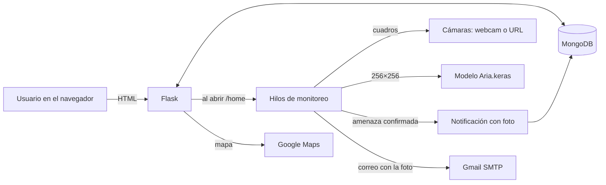
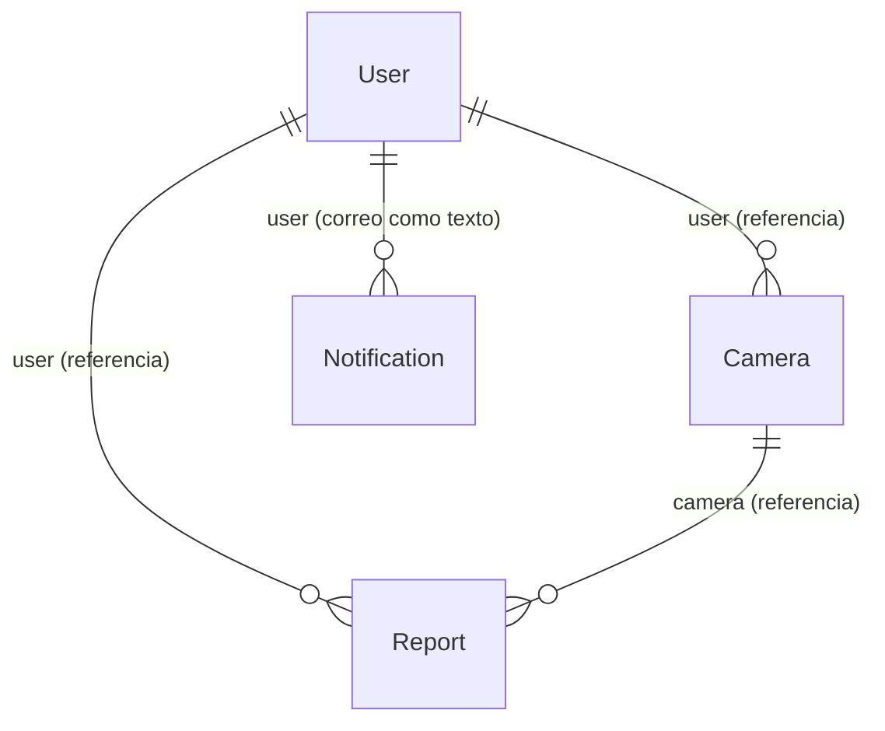

# Cómo funciona AlertAI

## Vista general

La aplicación sigue el patrón *application factory* de Flask: `create_app()` en `flasky/app/__init__.py` registra seis *blueprints*.

| Blueprint | Prefijo | Qué hace |
|---|---|---|
| `main` | `/` | Página pública de presentación |
| `auth` | `/auth` | Registro, inicio de sesión, confirmación por código y cambio de contraseña |
| `home` | `/` | Lista de cámaras, alta, edición, borrado y **monitoreo con la IA** |
| `alert` | `/alert` | Notificaciones: lista, detalle, búsqueda, destacadas y borrado |
| `admin` | `/admin` | Panel del administrador: todas las cámaras y reportes |
| `help` | `/help` | Ayuda y formulario para reportar problemas por correo |

Extensiones: Flask-Bootstrap, Flask-Login (sesión), Flask-Mail (correo), Flask-WTF (formularios) y Flask-MongoEngine (base de datos).

## Modelo de datos (`app/models.py`)

Por qué existe cada documento y cada modelo Pydantic: ver [decisiones.md](decisiones.md).

**User**
- `username`, `email` (único) y `password_hash`, generado con Werkzeug.
- `confirmed`: queda en `True` sola si el correo es el de `FLASKY_ADMIN`.
- `available`: no se usa en el código.

**Camera**
- `name`, `phone_number` (10 dígitos) y `camera_type`: `WebCamera` o `SecurityCamera`.
- `url`, para las cámaras de seguridad.
- `device_id` y `registered`, que es el nombre de la computadora donde se registró. Solo esa computadora la monitorea.
- `place`: `Home`, `Building`, `Square`, `Street` o `Personalized`.
- `address`, `latitude` y `longitude`.
- `alerts`: las alertas activas.
- `alerts_default` y `place_default`: los valores originales, para regresar a ellos.
- `user`: referencia al usuario. Si se borra el usuario, se borran sus cámaras.

**Notification**
- `user`: el correo del usuario, guardado como texto.
- `date_time`, `place`, `threat`, `camera_name` y `certainty` (texto, como "97.31%").
- `image`: la foto en PNG.
- `read` y `starred`.

**Report**
- Un usuario marca una notificación como errónea con `title` y `body`.
- Guarda `label` (la amenaza), la foto y referencias a usuario y cámara.
- El administrador los revisa. Se guardan como máximo 25; al llegar al límite se borra el más viejo.

### Alertas por lugar

Al registrar una cámara se eligen sus alertas según el lugar, o una por una en `Personalized`:

| Lugar | Alertas |
|---|---|
| Casa (`Home`) | Incendios, arma blanca, apuñalamiento, arma corta, ataque de perro |
| Edificio (`Building`) | Incendios, arma blanca, arma corta, arma larga, choque |
| Plaza (`Square`) | Incendios, arma blanca, arma corta, arma larga, ataque de perro, peleas |
| Calle (`Street`) | Todas menos persona herida |

Las 10 alertas posibles son `fires`, `bladed_weapon`, `stabbing`, `handgun`, `long_gun`, `cannoning`, `dog_attack`, `car_accident`, `brawls` e `injured_people`.

## Flujos

### Registro y confirmación

1. `/auth/signup` crea al usuario e inicia su sesión.
2. Se genera un código de 10 caracteres a partir de un SHA-256 del correo, la contraseña cifrada y el nombre.
3. El código se guarda en la sesión con vencimiento de **3 minutos** y se envía por correo.
4. En `/auth/check` el usuario escribe el código. Se firma con `SECRET_KEY` y se valida en `/auth/confirm/<token>`.
5. Mientras la cuenta no esté confirmada, cualquier página fuera de `auth`, `main` y `admin` lo regresa a `/auth/unconfirmed`.

### Recuperar la contraseña

`/auth/reset` envía un código igual al de confirmación. `/auth/check` lo redirige a `/auth/confirm/<token>/<email>`, que inicia la sesión. Después, `/auth/password_reset` cambia la contraseña.

### Agregar una cámara

`/addCamera` lista las cámaras del equipo con WMI de Windows (dispositivos "USB Video Device") y probando índices de OpenCV. El usuario elige el tipo, la URL si es de seguridad, el lugar o las alertas, la dirección en un mapa de Google y un teléfono. La cámara queda registrada con el nombre de la computadora.

### Monitoreo (`home/views.py`)

Al abrir `/home`:

1. Se carga el modelo desde `ALERTAI_MODEL_PATH`, solo la primera vez.
2. Por cada cámara del usuario que no se esté vigilando ya, o cuyo hilo terminó, se inicia un **hilo** con `start_camera_monitoring`.
3. Cada hilo:
   - se salta la cámara si se registró en otra computadora;
   - abre la cámara: la URL si es de seguridad, o la cámara elegida si es webcam;
   - lee un cuadro, lo pasa a RGB, lo reduce a 256 × 256, lo pasa a valores de 0 a 1 y lo clasifica;
   - si la clase no es "Normalidad" (9) y la certeza pasa de **95 %**, guarda la clase en una lista y entra en *modo alerta*;
   - fuera del modo alerta, espera 1 segundo entre cuadros; dentro, analiza sin pausa;
   - si pasan 20 segundos sin detecciones, vacía la lista y sale del modo alerta.
4. Cada vez que hay una detección se revisa la lista con estos umbrales, en este orden. Las reglas viven en `app/detection.py`:

| Amenaza notificada | Clases que cuenta | Detecciones necesarias | Alerta que debe tener la cámara |
|---|---|---|---|
| Armas de fuego | 1 Arma corta, 2 Arma larga, 5 Encañonamiento | 10 | `handgun`, `long_gun` o `cannoning` |
| Armas blancas | 0 Arma blanca | 10 | `bladed_weapon` o `stabbing` |
| Ataque de perros | 3 Ataque de perro | 15 | `dog_attack` |
| Incendios | 8 Incendio | 20 | `fires` |
| Choques | 4 Choques | 30 | `car_accident` |
| Persona herida | 11 Persona herida | 30 | `injured_people` |
| Pelea | 6 Forcejeos, 7 Golpe, 10 Patada | 30 | `brawls` |
| Encañonamiento | 5 Encañonamiento | 10 | `cannoning` |

   Solo se revisa la primera regla que alcanza su umbral. Si la cámara no tiene esa alerta, no se notifica nada en esa vuelta.

5. Al confirmar una amenaza, si no hubo otra igual en los últimos **3 minutos**:
   - se guarda una `Notification` con la foto en PNG;
   - se envía un correo con la foto adjunta y un enlace al detalle, construido con `ALERTAI_BASE_URL`;
   - si el usuario tiene más de 500 notificaciones sin destacar, se borra la más vieja.
6. Si la cámara se desconecta, se intenta reconectar una vez. Si no lo logra, se envía un correo de "cámara desconectada".

### Notificaciones (`/alert`)

- **Lista:** páginas de 25 notificaciones, con búsqueda por lugar, amenaza, cámara o certeza.
- **Detalle:** muestra la foto y la marca como leída.
- **Destacadas:** se pueden marcar y filtrar; el límite es 100.
- **Borrar todas:** borra las que no están destacadas.
- **Reportar:** desde una notificación se puede reportar como error, y eso crea un `Report`.

### Administrador (`/admin`)

Si el correo coincide con `FLASKY_ADMIN`, al iniciar sesión va directo a `/admin/cameras`, donde ve todas las cámaras. También puede revisar los reportes en `/admin/reports`.

### Ayuda (`/help`)

Muestra una página de ayuda y un formulario que envía el problema por correo a `SUPPORT_EMAIL`.

## Correos

`app/email.py` los envía en un hilo aparte con Flask-Mail. Cada plantilla tiene versión `.txt` y `.html`.

| Plantilla | Cuándo |
|---|---|
| `auth/email/confirm` | Al registrarse o pedir otro código |
| `auth/email/reset_password` | Al pedir cambiar la contraseña |
| `alert/email/alert` | Al confirmar una amenaza; lleva la foto adjunta |
| `alert/email/camera_disconected` | Si una cámara no se puede reconectar |
| `help/email/report_problem` | Al reportar un problema |
| `mail/new_user` | Plantilla para avisar de un usuario nuevo; no se usa en el código |

El SMS por Twilio, `send_alert_message_sms`, existe pero su llamada está comentada.

## Rutas

Los botones de borrar mandan un formulario POST con el token CSRF de la página (`static/Js/confirmDelete.js`). Las rutas que borran rechazan cualquier otra cosa.

| Ruta | Método | Requiere | Qué hace |
|---|---|---|---|
| `/` | GET | — | Página de presentación |
| `/auth/signup`, `/auth/login` | GET, POST | — | Registro e inicio de sesión |
| `/auth/logout` | GET | Sesión | Cerrar sesión |
| `/auth/check`, `/auth/confirm`, `/auth/confirm/<token>` | Varía | Varía | Confirmación por código |
| `/auth/reset`, `/auth/confirm/<token>/<email>`, `/auth/password_reset` | Varía | Varía | Recuperar contraseña |
| `/home` | GET | Sesión | Cámaras e **inicio del monitoreo** |
| `/addCamera`, `/editCamera/<id>` | GET, POST | Sesión, dueño | Agregar y editar cámaras |
| `/deleteCamera/<id>` | POST + CSRF | Sesión, dueño | Borrar una cámara |
| `/reportNotification/<id>` | GET, POST | Sesión, dueño | Reportar una notificación |
| `/alert/notifications` | GET | Sesión | Lista de notificaciones |
| `/alert/notifications/view/<id>` | GET | Sesión, dueño | Detalle |
| `/alert/notifications/search_notifications` | GET, POST | Sesión | Búsqueda |
| `/alert/filterStarred` | GET | Sesión | Solo destacadas |
| `/alert/add-QuitStarred/<id>` | GET | Sesión, dueño | Destacar o quitar |
| `/alert/notifications/delete/<id>` | POST + CSRF | Sesión, dueño | Borrar una notificación |
| `/alert/deleteAllNotifications` | POST + CSRF | Sesión | Borrar las no destacadas |
| `/admin/cameras`, `/admin/reports`, `/admin/reports/<id>` | GET | Admin | Panel |
| `/admin/delete/<id>` | POST + CSRF | Admin | Borrar cualquier cámara |
| `/help/help`, `/help/report_support` | GET, POST | Sesión | Ayuda |

## Interfaz

Las plantillas de `templates/` extienden `base.html`, con Bootstrap, Font Awesome y fuentes de Google. Los scripts de `static/Js/` son:

| Archivo | Qué hace |
|---|---|
| `addCameraDOM.js` | Muestra u oculta el campo de URL y las alertas personalizadas |
| `placeCheckBox.js` | Marca las alertas según el lugar elegido |
| `googleMapService.js` y `googleMapPopup.js` | Mapa emergente con búsqueda de direcciones; llena latitud y longitud |
| `cards.js` | Expande las tarjetas de cámaras |
| `confirmDelete.js` | Pide confirmación antes de borrar |

La página de inicio de sesión muestra un dato curioso al azar.
